# NCI H8WBD CA1

## Images
Sources used:
- unsplash.com
- pexels.com
- ireland.com
- oldhead.com
- royalportrushgolfclub.com
- watervillegolflinks.ie
- royalcountydown.org
- lanhinchgolf.com
- portmarnockgolfclub.ie
- adaremanor.com
- portstewartgc.co.uk/the-strand/

## AI Image Generation
AI was utilised to generate the following image(s).
- founder.jpeg
This image was created with the following prompt
```
Professional headshot of a distinguished Irish luxury travel concierge advisor in his early 40s wearing a tailored tweed blazer, friendly warm smile, subtle historic clubhouse background with soft focus, premium lighting, high-resolution photography
```
It produced the following image
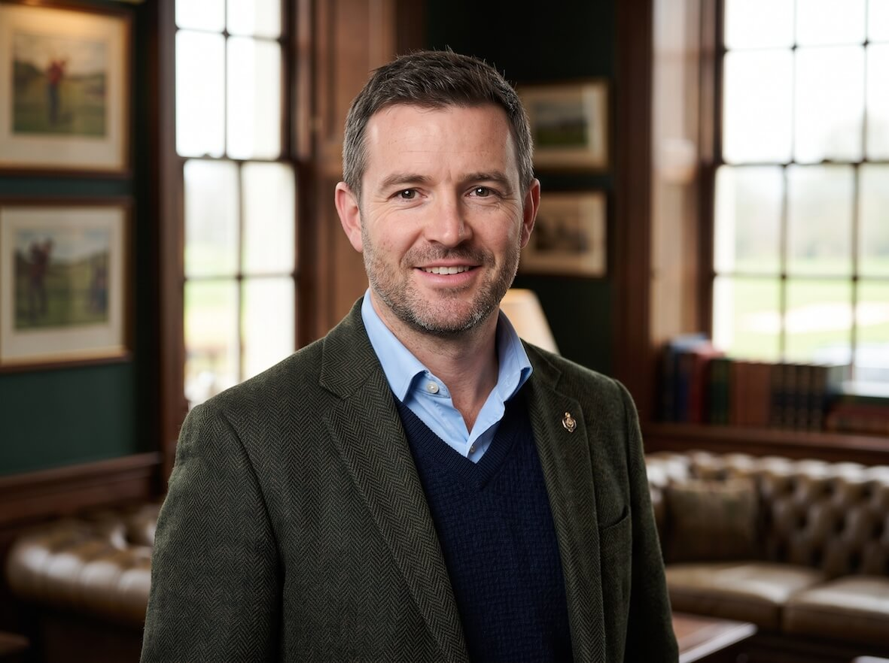

AI was used as I was not able to find a suitable image from usual sources that was appropriate. I used the Google Gemini Nano Banana model to produce a 4:3 ratio image. It is a small image on the site used in multiple pages.

Here is a screenshot of the prompt being run, and the resulting image. I then resized the image and optimised it using tinypng.com before adding it to the images folder. The screenshot has not been altered in anyway.

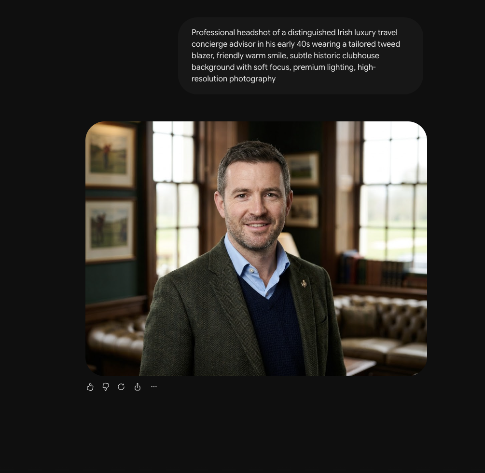

## AI Content Generation
Google Gemini was used to generate the short descriptions for most of the card summaries in the carousel on the homepage. I will most likely use this text elsewhere as well.
I used a generic prompt of "can you give me a two sentence summary about (name of course)" for each of the courses. I then in most cases modified the response when adding it to the card. Old Head and Brittas Bay were manually created based on content from their websites. Original list of top courses taken from https://www.golfdigest.com/story/worlds-100-greatest-golf-courses

Here are the full list of requests and responses, along with screenshot evidence:

1. ### Royal County Down
   - Request = ```can you give me a two sentance summary about Royal County Down golf course```
   - Response = ```Located in Northern Ireland beneath the spectacular Mountains of Mourne, Royal County Down is a historic 1889 club that is consistently ranked among the greatest golf courses in the world. Its renowned Championship links course is celebrated for its breathtaking natural scenery and its exceptionally challenging, rugged layout featuring narrow fairways, deep bunkers, and natural sand dunes.```
   <br>

   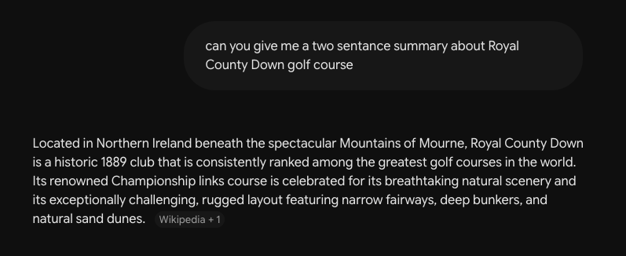
   
   <br>
2. ### Ballybunion Golf Club
    - Request = ```can you give me a shorter two sentance summary for ballybunion golf club```
    - Response = ```Located on County Kerry's dramatic Atlantic coastline, Ballybunion Golf Club is a legendary Irish links famous for its towering sand dunes. Its historic Old Course offers a thrilling and unforgiving test of golf that consistently ranks among the world's best.```
    <br>

    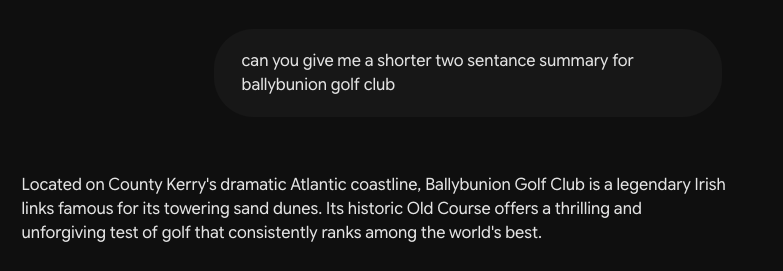
    
    <br>
3. ### Royal Portrush Golf Club
    - Request = ```Can you give me a two sentance summary about Royal portrush golf club```
    - Response = ```Situated on the rugged Causeway Coast in Northern Ireland, Royal Portrush Golf Club is a historic venue renowned for its spectacular Dunluce Links. As the only club outside mainland Great Britain to ever host The Open Championship, it offers a dramatic and exceptionally demanding test of links golf among towering sand dunes and deep ravines.```
    <br>
    
    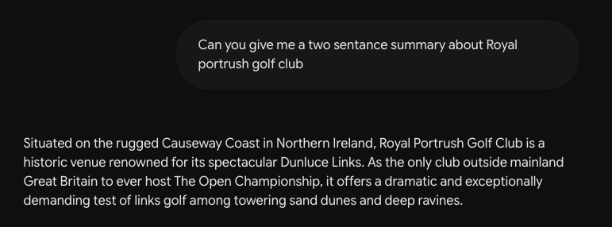
    
    <br>
4. ### Lahinch Golf Club
    - Request = ```Can you give me a two sentance summary about Lahinch golf club```
    - Response = ```Located on the breathtaking coastline of County Clare, Lahinch Golf Club is a historic Irish links course often referred to as the "St Andrews of Ireland." Its revered Old Course, shaped by golfing legends Old Tom Morris and Alister MacKenzie, is famous for its towering sand dunes, quirky blind shots, and resident weather-predicting goats.```
    <br>
    
    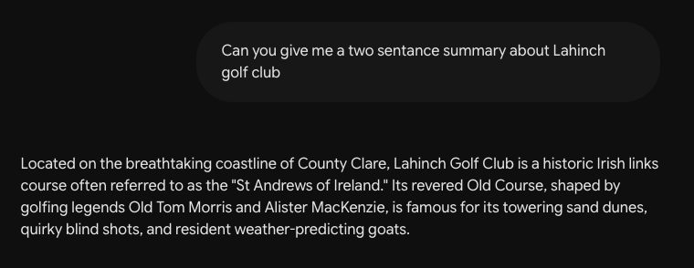
    
    <br>
5. ### Portmarnock
    - Request = ```can you give me a two sentance summary about portmarnock golf club```
    - Response = ```Situated on a narrow sandy peninsula just north of Dublin, Portmarnock Golf Club is a world-renowned championship links course surrounded by water on three sides. With its consistently flat but demanding terrain, deep pot bunkers, and exposure to unpredictable coastal winds, this historic venue provides one of the purest and fairest tests of traditional links golf.```
    <br>
    
    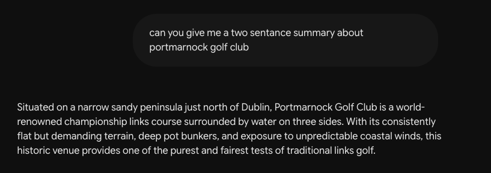
    
    <br>
6. ### Waterville
    - Request = ```Can you give me a two sentance summary about Waterville Golf Links in Ireland.```
    - Response = ```Located on the scenic Ring of Kerry in southwest Ireland, Waterville Golf Links is a spectacular championship course completely surrounded by the Atlantic Ocean and the Inny River estuary. Renowned for its stunning coastal views, massive sand dunes, and challenging layout, it offers a beautifully remote and unforgettable test of pure links golf.```
    <br>
    
    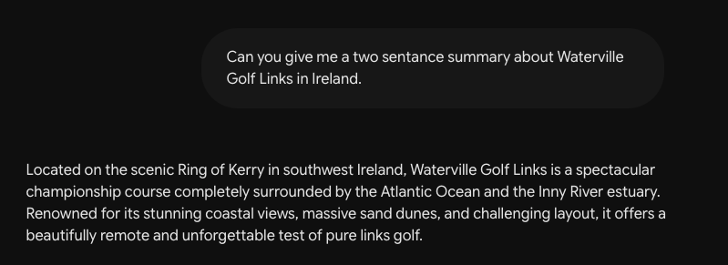
    
    <br>
7. ### St Patricks Links Golf Club   
    - Request = ```can you give me a two sentance summary of St Patricks Links golf course in county donegal```
    - Response = ```Located along the stunning shores of Sheephaven Bay at the Rosapenna Hotel & Golf Resort in County Donegal, St Patrick's Links is a modern masterpiece designed by renowned architect Tom Doak. Carved through a massive dune system that originally housed 36 holes, this sprawling 18-hole layout offers breathtaking coastal views and has quickly established itself as one of the world's premier links courses since opening in 2021.```
    <br>
    
    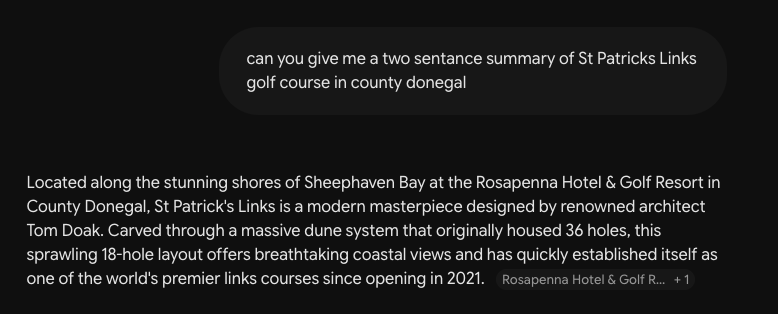
    
    <br>
8. ### Carne Golf Links
    - Request = ```Can you give me a two sentance summary of Carne golf links in county mayo```
    - Response = ```Located on the remote Belmullet Peninsula in County Mayo, Carne Golf Links is a spectacularly wild and dramatic course that was the final masterpiece of renowned Irish architect Eddie Hackett. Carved through towering, untamed sand dunes overlooking the Atlantic Ocean, it offers a purely authentic and incredibly rugged test of traditional links golf.```
    <br>
    
    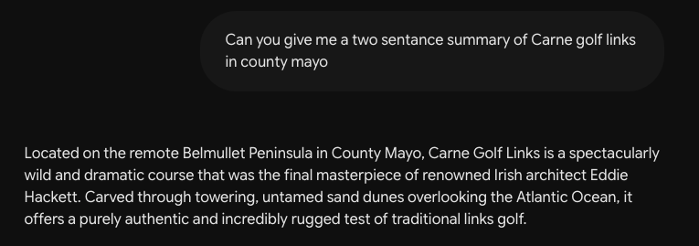
    
    <br>
9. ### Adare Manor
    - Request = ```can you give me a two sentance summary of adare manor golf course```
    - Response = ```Set on an 840-acre estate in County Limerick, The Golf Course at Adare Manor is a flawlessly manicured, Tom Fazio-designed parkland masterpiece. Slated to host the 2027 Ryder Cup, this pristine layout is renowned for its wall-to-wall bentgrass, total absence of rough, and immaculate conditioning that rivals the finest courses in the world.```
    <br>
    
    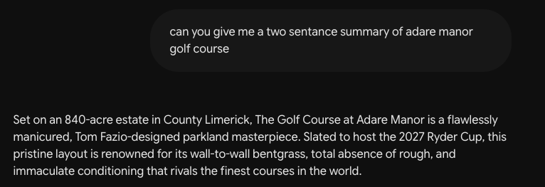
    
    <br>
10. ### Portstewart Golf Club 
    - Request = ```can you give me a two sentence summary of portstewart golf club, the strand course```
    - Response = ```Set on Northern Ireland's spectacular Causeway Coast, Portstewart Golf Club's Strand Course is a world-class links renowned for winding through some of the tallest and most rugged sand dunes in the country. Famous for possessing one of the most dramatic and highly-rated opening holes in all of golf, this championship layout offers a thrilling, visually stunning test that hosted the 2017 Irish Open.```
    <br>
    
    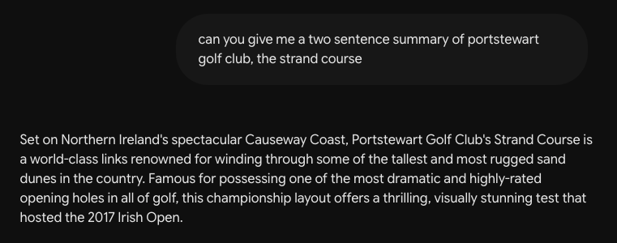
    
    <br>
11. ### Colt Championship Course County Sligo Golf Club
    - Request = ```can you give me a two sentence summary of the colt championship golf course at county sligo golf club```
    - Response = ```Located on the picturesque Rosses Point peninsula beneath the majestic backdrop of Benbulben mountain, the Colt Championship Course at County Sligo Golf Club is a traditional links masterpiece designed by the legendary Harry Colt. Renowned for its dramatically undulating fairways, deep pot bunkers, and exposure to fierce Atlantic winds, this historic layout provides a spectacular and demanding test that has long hosted the prestigious West of Ireland Championship.```
    <br>
    
    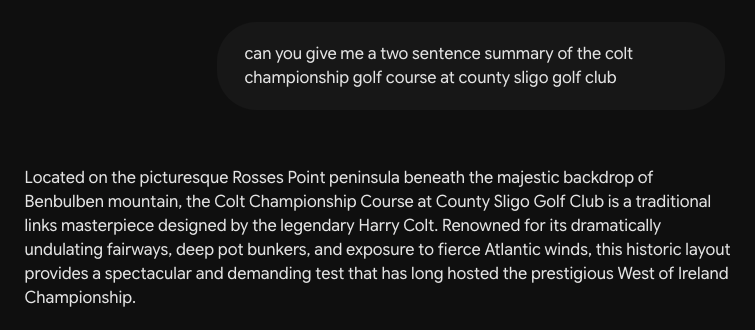
    
    <br>
12. ### Tralee Golf Club
    - Request = ```can you give me a two sentence summary of tralee golf club```
    - Response = ```Situated on a rugged coastal peninsula in County Kerry, Tralee Golf Club is a spectacular links course famously marking Arnold Palmer's first European design. Renowned for its massive sand dunes, dramatic cliffside holes, and breathtaking views of the Atlantic Ocean, its back nine is widely considered one of the most stunning stretches in world golf.```
    <br>
    
    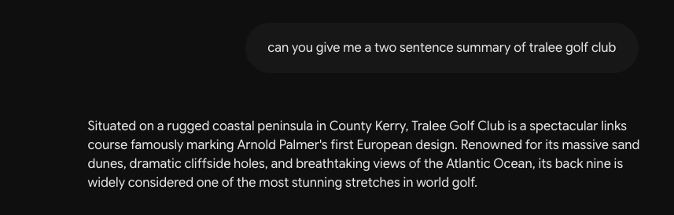
    
    <br>
13. ### Ballyliffin Golf Club
    - Request = ```can you give me a two sentence summary of Ballyliffin golf club```
    - Response = ```I'm having a hard time fulfilling your request. Can I help you with something else instead?Situated on the remote Inishowen Peninsula in County Donegal, Ballyliffin Golf Club is Ireland's most northerly golf complex and boasts two outstanding championship links courses. Set amidst towering natural sand dunes and offering breathtaking coastal views, its highly regarded Glashedy and Old Links provide a formidable and spectacular test of traditional golf that famously hosted the 2018 Irish Open.```
    <br>
    
    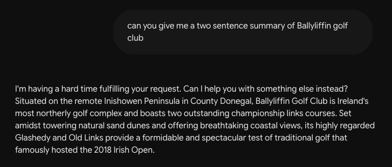
    
    <br>

### Experiences packages
I used google gemini to come up with 15 different example travel packages.
- prompt = ```Please create 15 different golf holiday itineraries for a luxury golf trip to ireland: include luxury accomodation, and each day playing golf. You can assume that private helicopter charters are available for transport, or chaffeur driven limo. Despite transport being available and unrestricted keep the itineraries to as short a travel time between courses as possible, no cross country trips every day. The courses that are available are as follows:
old head kinsale
royal county down
ballybunion golf course
royal portrush
st. patricks links
lahinch
portmarnock
waterville
carne
brittas bay golf course - assume it is open
adare manor
portstewart
county sligo golf club
tralee golf course
ballyliffin golf club glashedy

make each itinerary unique, 15 in total.
```
response = ```### 1. The South West Kingdom

| Day | Golf Course | Luxury Accommodation | Transport |
| --- | --- | --- | --- |
| 1 | Adare Manor | Adare Manor, Limerick | Limo |
| 2 | Ballybunion Golf Course | Adare Manor, Limerick | Limo |
| 3 | Tralee Golf Course | Adare Manor, Limerick | Heli |
| 4 | Lahinch Golf Club | Adare Manor, Limerick | Heli |

### 2. Northern Majesty

| Day | Golf Course | Luxury Accommodation | Transport |
| --- | --- | --- | --- |
| 1 | Royal Portrush | The Bushmills Inn, Antrim | Limo |
| 2 | Portstewart | The Bushmills Inn, Antrim | Limo |
| 3 | Royal County Down | Slieve Donard, Down | Heli |

### 3. Donegal Discovery

| Day | Golf Course | Luxury Accommodation | Transport |
| --- | --- | --- | --- |
| 1 | St. Patrick's Links | Rosapenna Hotel & Golf Resort | Limo |
| 2 | Ballyliffin Golf Club Glashedy | Rosapenna Hotel & Golf Resort | Heli |

### 4. East Coast Elite

| Day | Golf Course | Luxury Accommodation | Transport |
| --- | --- | --- | --- |
| 1 | Portmarnock | The Merrion Hotel, Dublin | Limo |
| 2 | Brittas Bay Golf Course | The Merrion Hotel, Dublin | Limo |

### 5. Wild Mayo & Sligo

| Day | Golf Course | Luxury Accommodation | Transport |
| --- | --- | --- | --- |
| 1 | Carne | Mount Falcon Estate, Mayo | Heli |
| 2 | County Sligo Golf Club | Mount Falcon Estate, Mayo | Limo |

### 6. The Kerry Coastline

| Day | Golf Course | Luxury Accommodation | Transport |
| --- | --- | --- | --- |
| 1 | Waterville | The Europe Hotel & Resort, Killarney | Heli |
| 2 | Tralee Golf Course | The Europe Hotel & Resort, Killarney | Limo |
| 3 | Ballybunion Golf Course | The Europe Hotel & Resort, Killarney | Limo |

### 7. Munster Masterpieces

| Day | Golf Course | Luxury Accommodation | Transport |
| --- | --- | --- | --- |
| 1 | Old Head Kinsale | Hayfield Manor, Cork | Limo |
| 2 | Waterville | Adare Manor, Limerick | Heli |
| 3 | Ballybunion Golf Course | Adare Manor, Limerick | Limo |
| 4 | Adare Manor | Adare Manor, Limerick | Limo |

### 8. North West Coastal Sweep

| Day | Golf Course | Luxury Accommodation | Transport |
| --- | --- | --- | --- |
| 1 | County Sligo Golf Club | Lough Eske Castle, Donegal | Heli |
| 2 | St. Patrick's Links | Lough Eske Castle, Donegal | Heli |
| 3 | Ballyliffin Golf Club Glashedy | Lough Eske Castle, Donegal | Heli |
| 4 | Royal Portrush | Lough Eske Castle, Donegal | Heli |

### 9. The Shannon Estuary Swing

| Day | Golf Course | Luxury Accommodation | Transport |
| --- | --- | --- | --- |
| 1 | Lahinch Golf Club | Dromoland Castle, Clare | Limo |
| 2 | Adare Manor | Dromoland Castle, Clare | Limo |
| 3 | Ballybunion Golf Course | Dromoland Castle, Clare | Heli |

### 10. The Celtic Sea & Atlantic Link

| Day | Golf Course | Luxury Accommodation | Transport |
| --- | --- | --- | --- |
| 1 | Old Head Kinsale | Castlemartyr Resort, Cork | Limo |
| 2 | Tralee Golf Course | Castlemartyr Resort, Cork | Heli |
| 3 | Waterville | Castlemartyr Resort, Cork | Heli |

### 11. Dublin to Down

| Day | Golf Course | Luxury Accommodation | Transport |
| --- | --- | --- | --- |
| 1 | Brittas Bay Golf Course | The Shelbourne, Dublin | Limo |
| 2 | Portmarnock | The Shelbourne, Dublin | Limo |
| 3 | Royal County Down | The Shelbourne, Dublin | Heli |

### 12. The Rugged Edge

| Day | Golf Course | Luxury Accommodation | Transport |
| --- | --- | --- | --- |
| 1 | Carne | Ashford Castle, Mayo | Heli |
| 2 | County Sligo Golf Club | Ashford Castle, Mayo | Heli |
| 3 | Lahinch Golf Club | Ashford Castle, Mayo | Heli |

### 13. Antrim to Donegal Express

| Day | Golf Course | Luxury Accommodation | Transport |
| --- | --- | --- | --- |
| 1 | Portstewart | Galgorm Resort, Antrim | Limo |
| 2 | Royal Portrush | Galgorm Resort, Antrim | Limo |
| 3 | Ballyliffin Golf Club Glashedy | Galgorm Resort, Antrim | Heli |

### 14. The Ultimate West Coast

| Day | Golf Course | Luxury Accommodation | Transport |
| --- | --- | --- | --- |
| 1 | Adare Manor | Adare Manor, Limerick | Limo |
| 2 | Lahinch Golf Club | Adare Manor, Limerick | Heli |
| 3 | Ballybunion Golf Course | Adare Manor, Limerick | Limo |
| 4 | Tralee Golf Course | Adare Manor, Limerick | Heli |
| 5 | Waterville | Adare Manor, Limerick | Heli |

### 15. The Grand Northern Arc

| Day | Golf Course | Luxury Accommodation | Transport |
| --- | --- | --- | --- |
| 1 | Royal County Down | Culloden Estate & Spa, Belfast | Heli |
| 2 | Royal Portrush | Culloden Estate & Spa, Belfast | Heli |
| 3 | Portstewart | Culloden Estate & Spa, Belfast | Limo |
| 4 | St. Patrick's Links | Culloden Estate & Spa, Belfast | Heli |
```
<br>

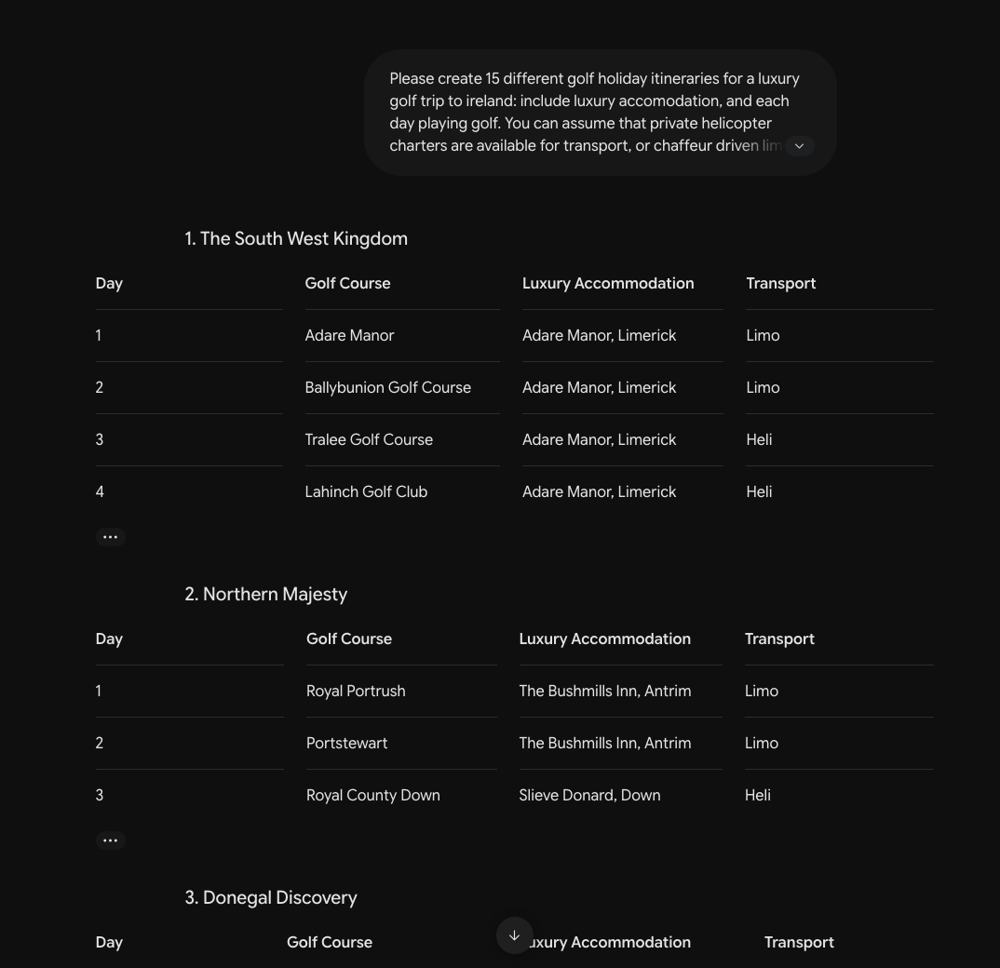


## File Validation
All files were validated, experiences/index.html has two errors due to select elements gaining placeholder values which is not a valid attribute for the select element. The javascript package used for the two select boxes allows placeholder values which requires the normally unavailable placeholder attribute. The additional functionality in this case was deemed worth the validation error.